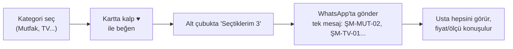

> 13 Kasım 2026 tarihli Gemini analizinin korunmuş kopyasıdır. Aşağıdaki ölçümler revizyon öncesine aittir. Güncel uygulama ve kontroller: [SITE_REVIZYON_DURUMU.md](SITE_REVIZYON_DURUMU.md).

# Şimşek Mobilya — UX/UI Analizi ve Öneriler (Revize)

> [!NOTE]
> **Revizyon:** "Referans fotoğraflar / telif" maddesi rapordan çıkarıldı. Site bir **katalog**; örnek modeller müşterinin *"ben bunu istiyorum"* diyebilmesi için orada. Bu yüzden onları sorun değil, **sitenin ana ürünü** sayıp tüm analizi "müşteri beğendiği modeli nasıl en kolay seçer ve ustaya nasıl en kolay ulaşır?" sorusu üzerine kurdum.

**Yöntem:** Kod + gerçek tarayıcıda (masaüstü 1440, tablet 820, mobil 390) ölçüm ve ekran görüntüleri. Ölçülenler: yazı boyutları, dokunma alanları, yükleme boyutu, JS hataları, lightbox akışı.

| Ölçüm | Sonuç |
|---|---|
| İlk yükleme | ~**500 KB**, 18 istek, **JS hatası yok** ✅ |
| Yatay taşma | Yok (3 cihazda) ✅ |
| 14px'den küçük metin | Masaüstü **52 öğe**, mobil **63 öğe** (en küçüğü **9px**) ❌ |
| 44px altı dokunma alanı | Üst menü linkleri **22px** yüksek; "Tüm modeller / Modelleri inceleyin / Birlikte konuşalım" **21–24px** ❌ |
| Sayfa uzunluğu | Masaüstü 4075px, mobil 4946px (makul) |
| Mobilde sabit "krom" | Header 72 + filtre çubuğu 56 + alt Ara/WhatsApp çubuğu ~68 = **~196px / 844px** → ekranın **%23'ü** hep kapalı ❌ |

**Genel puan: 6.5 / 10.** Altyapı sağlam, ama tasarım *"temiz ama kişiliksiz bir şablon"* ve katalog **"seçme"** deneyimini desteklemiyor: kullanıcı sadece bakıyor, **seçip biriktiremiyor**.

---

## 1. İki kişinin gözünden site

### 👤 Müşteri (50 yaşında, telefonda, teknolojiden anlamıyor)
| Soru | Sitenin cevabı |
|---|---|
| "Ne yapıyorlar?" (5 sn) | ✅ Başlık + mutfak fotoğrafı yeterince net |
| "Fiyatı ne kadar?" | ❌ Hiçbir ipucu yok. Müşterinin **1 numaralı sorusu**; "Bu modeli sor" bunu karşılamıyor |
| "Beğendiklerimi nasıl saklarım / eşime gösteririm?" | ❌ Yok. Ekran görüntüsü alıp atmak zorunda |
| "Bunları kim, nerede yapıyor? Güvenilir mi?" | 🟡 Atölye fotoğrafı güzel ama kısa; yorum/örnek hikâye yok |
| "Aramak/yazmak zor mu?" | ✅ Büyük butonlar, alt çubuk |
| "Yazılar okunuyor mu?" | ❌ Rozet, model sayısı, açıklamalar çok küçük |

### 🔨 Esnaf (Bayram Usta)
| İhtiyaç | Durum |
|---|---|
| Müşteri "hangi modeli" istediğini söylesin | ✅ `ŞM-XXX-NN` + hazır WhatsApp mesajı. Güçlü |
| Siteye **kendisi** yeni fotoğraf ekleyebilsin | ❌ Şu an terminal, `make photos`, JSON düzenleme gerekiyor — usta **hiç** yapamaz |
| Hangi modele ilgi var görebilsin | ❌ Ölçüm yok |
| Kartvizit / tabela / araç üstü için tek kısa link, QR | ❌ Alan adı ve QR yok |
| Telefon çalsın, boş iş olmasın | 🟡 Ara/WhatsApp var; "Sizi arayalım" yok |

---

## 2. En büyük fırsat: "Seçtiklerim" akışı ⭐

Katalog sitesinin asıl işi **seçtirmek**. Şu an akış: fotoğrafa bak → tek tek "Bu modeli sor". Müşteri 3-4 model beğenir ama hepsini ayrı ayrı sormak zorunda.

**Önerilen akış:**



- Kalp ikonu her kartta (büyük, 48px). Tıklanınca kalp dolar, küçük "pop" animasyonu.
- Alt sabit çubuk **seçim varken** şuna dönüşür: `♥ 3 model seçtiniz · [WhatsApp'ta gönder]`. Seçim yoksa mevcut Ara/WhatsApp çubuğu kalır.
- Mesaj hazır: *"Merhaba, şu modelleri beğendim: ŞM-MUT-02, ŞM-TV-01, ŞM-ANT-03. Bilgi alabilir miyim?"*
- Seçimler `localStorage`'da saklanır (sayfa kapansa da kalır). Teknik zorluğu çok düşük, **etkisi en yüksek** özellik.
- Ustaya yararı: müşteri ne istediğini önceden netleştirmiş geliyor; konuşma "ne istiyorsunuz?" yerine "bunlardan hangisi?" ile başlıyor.

**Her modele kalıcı link:** `…/#model/ŞM-MUT-02`. Müşteri eşine/ustaya linki atabilir; usta "şu modeli" diye gönderebilir. Lightbox açıldığında adres çubuğu güncellensin.

---

## 3. Önerilen sayfa sıralaması (bilgi mimarisi)

| # | Şimdi | Önerilen | Gerekçe |
|---|---|---|---|
| 1 | Header | Header: logo + **numara görünür** + Ara | Numara için kaydırmak gerekmesin |
| 2 | Hero (yarı yarıya) | **Hero: geniş fotoğraf + "Ne arıyorsunuz?" büyük kategori düğmeleri** | İlk ekranda hem etkileyici hem yönlendirici |
| 3 | Rozet şeridi (küçük yazı) | **"Neden Şimşek?" 3 büyük kart** (ikon + başlık + 1 cümle) | Şu hali okunmuyor |
| 4 | Kategori kartları | ❌ **Kaldır, hero'daki kategori düğmeleriyle birleştir** | Katalog sekmeleriyle aynı işi yapıyor, yetim kart satırı bırakıyor |
| 5 | Katalog (sekmeler) | **Katalog: kategori çipleri + "Bizim işlerimiz / Örnek modeller" çipi + kalp** | Seçme deneyimi |
| 6 | — | ➕ **Nasıl çalışıyoruz? (4 adım)** | Belirsizlik korkusunu azaltır |
| 7 | Atölye | **Atölye + usta (video veya 3 foto) + kısa yazı** | Güven |
| 8 | — | ➕ **Müşteri yorumları** (WhatsApp ekran görüntüsü, izinle) | En güçlü ikna |
| 9 | — | ➕ **Sık sorulan sorular** (3-5 madde) | Telefonu yormadan cevap |
| 10 | İletişim | **İletişim: büyük numara, Ara/WhatsApp/Yol tarifi, harita, "Sizi arayalım"** | Dönüşüm noktası |

### Mobil için çerçeve (wireframe)
```
┌──────────────────────┐
│ ☰ Şimşek    0532 652…│  ← numara görünür
├──────────────────────┤
│  [ GENİŞ FOTOĞRAF ]  │
│  Hayalinizdeki mutfağı│
│  birlikte yapalım.   │
│  [Mutfak][TV][Kahve] │  ← büyük kategori düğmeleri
│  [Antre][Gömme][+3]  │
│  [📞 Hemen Ara]      │
├──────────────────────┤
│ Neden Şimşek?        │
│ ▢ Ölçüye özel        │
│ ▢ Kendi atölyemiz    │
│ ▢ Yerinde montaj     │
├──────────────────────┤
│ KATALOG   [♥ 0]      │
│ (Hepsi)(Bizim işler) │
│ ┌────┐ ┌────┐        │
│ │ ♥  │ │ ♥  │ …      │
├──────────────────────┤
│ Nasıl çalışıyoruz? 1-4│
│ Usta + atölye        │
│ Yorumlar · SSS       │
│ İletişim + Harita    │
└──────────────────────┘
 [♥3 Seçtiklerim → WhatsApp]  ← sabit alt çubuk
```

---

## 4. UI / Görsel tasarım önerileri

### 4.1 Renk ve atmosfer
Mobilya = sıcaklık, ahşap, ev. Şu an palet gri-beyaz (`#f6f6f4` zemin, `#dedfe1` çizgi); plandaki sıcak krem/ceviz uygulanmamış.
- Zemin: **sıcak krem `#FFFAF4`**, bölüm arası **`#F6EBDD`** (açık meşe)
- Ana metin: **koyu ceviz `#2A1D14`**, ikincil `#6E5D50`
- Vurgu: mevcut turuncu `#E8731C` (Ara), WhatsApp yeşili yalnız WhatsApp için
- Kartlarda gri çizgi yerine **yumuşak sıcak gölge**; kart köşesi 6px yerine **14–16px**
- Bir bölümü (örn. "Neden Şimşek?" veya iletişim) **koyu ceviz zemin + krem yazı** yapın: sayfada ritim ve premium his yaratır

### 4.2 Tipografi
- Başlık fontu şu an Outfit (teknoloji hissi). **Serif başlık** (Fraunces / Playfair Display) → el işçiliği, "atölye" hissi, logodaki serif ile uyum.
- Gövde Inter kalabilir.
- **Taban 16px, asla 14px altı yok.** Mobilde şu an 9–12px olanlar: rozetler (10), "N model" (12), eyebrow (10), hero altyazısı (10), logo alt yazısı (9). Hepsi en az 14px.
- Model adı kartta **17px/600**; `Model No` küçük ve soluk (13px) kalabilir ama sadece ikincil bilgi olarak.

### 4.3 Logo
Header'daki logo, dokulu bej/kahverengi **kare bir JPEG**; temiz arayüzün içinde "yapıştırılmış etiket" gibi duruyor. **Şeffaf arka planlı PNG/SVG** versiyonu çıkarılmalı (ya da yuvarlak çerçeveye alınmalı). Favicon aynı kaynaktan.

### 4.4 Kart tasarımı (katalog)
- Fotoğraf oranı 4:3 sabit → dikey çekimler (antre aynası, TV duvarı, gömme dolap) **kırpılıp** değerli kısmı kayboluyor. Çözümler: kartlara `object-position` odak noktası, ya da **masonry (çok sütunlu, farklı yükseklik)**: modern ve daha zengin görünür.
- Kart bilgi hiyerarşisi: **Foto → büyük model adı → kalp**. "Uygulamamız" rozeti kalsın, ama **altın/turuncu şerit yerine ikonlu** ve fotoğrafın sağ üstünde.
- Hover (masaüstü): fotoğrafta çok hafif yakınlaşma (1.03), kartta gölge artışı, kalp belirir. Mobilde hover yok; kalp daima görünür.

### 4.5 Hero
- Şu anki hero fotoğrafı (L mutfak) teknik olarak iyi ama **çıplak sıva kenarı, bulaşık rafı, dağınık tezgâh** görünüyor; vitrin fotoğrafı için en güçlü seçim değil. Katalogdaki **ceviz çıtalı TV duvarı veya mor LED TV ünitesi** daha "vay" etkisi yapıyor.
- Mobilde hero fotoğrafı 2:1'lik küçük şeride sıkışmış: **tam genişlik, 4:3 veya 4:5** yapın.
- Başlık "Evinize göre mobilya." doğru ama sıradan. Seçenekler (ustaya onaylatın):
  - "Hayalinizdeki mobilyayı birlikte yapalım."
  - "Ölçünüze özel, evinize göre."
  - "Beğenin, ölçünüze göre yapalım."
- İkincil bağlantı "Modelleri inceleyin" küçük metin; **birincil** olması gerekebilir. Katalog sitesinde ilk eylem "Modellere bak", ikincisi "Ara".

### 4.6 Fotoğraf tutarlılığı
Kendi telefon çekimleri ile ilham referansları yan yana duruyor; farklı ışık/renk ısısı sayfayı dağınık gösteriyor. Web kopyaları için **hafif ve toplu bir düzeltme** (pozlama, beyaz dengesi, düzeltme açısı) fark yaratır. (Orijinaller dokunulmadan kalır.)
Ayrıca **"Bizim işlerimiz" çipi** ekleyin: müşteri istersen sadece gerçek işleri filtreleyebilsin. Bu, güveni artırır ve referansları "seçilecek örnek modeller" olarak doğru konumlandırır.

---

## 5. UX / Etkileşim önerileri

### 5.1 Mobil "krom" (sabit alanlar) diyeti
Header 72 + filtre 56 + alt çubuk 68 = ekranın %23'ü.
- Header'ı **aşağı kaydırınca gizle, yukarı kaydırınca göster**
- Filtre çubuğu 44px'e insin
- Alt çubuk ilk ekranda zaten hero'da butonlar varken **hero geçildikten sonra** (yumuşak yukarı kayarak) görünsün
- 3 işlevli alt çubuk: **Ara · WhatsApp · Konum**

### 5.2 Filtre çubuğu
- Yatay kaydırılabildiği belli değil (7. kategori ekran dışında). Sağ kenarda **solma efekti + küçük ok**.
- Mobilde çipler **büyük (48px)**, ikon + ad. Sayı rozetleri 14px.
- Filtre değiştirince sayfa sıçramasın; ızgara yumuşakça yenilensin.

### 5.3 Lightbox (büyütme penceresi)
Mevcut hali iyi (klavye, kaydırma, WhatsApp butonu) ama:
- ➕ **Pinch-zoom / çift dokun ile yakınlaştırma** (müşteri detay görmek ister)
- ➕ Alt tarafa **küçük önizleme şeridi** (aynı kategorideki diğerleri)
- ➕ **♥ Seç** düğmesi (kalp) lightbox'ta da
- ➕ **"Benzer modeller"** (aynı kategoriden 3 küçük kart)
- ➕ **Paylaş** (WhatsApp'ta eşine/arkadaşına gönder, model linkiyle)
- Metin tekrarı: başlık, model no, açıklama aynı bilgiyi üç kez söylüyor → **başlık + model no** yeter.
- "Bu modeli sor" yerine **"Bunu istiyorum"** / **"Fiyat öğren"** — müşterinin kafasındaki cümle bu.

### 5.4 Fiyat kaygısı
Müşteri fiyat görmeden harekete geçmekte tereddüt eder. Fiyat yazmadan çözümler (ustaya sorun, doğruysa):
- "**Ücretsiz keşif ve teklif**" (hero + iletişim)
- "**Fiyat ölçüye göre netleşir — 5 dakikada WhatsApp'tan öğrenin**"
- 4 adım bölümünde: "2. Ücretsiz ölçü ve teklif"

### 5.5 Telefon konusu: "Sizi arayalım"
Herkes aramak istemez. İletişim bölümüne **tek satır form**: *Adınız + Telefonunuz → "Sizi arayalım"*. (Formspree/Google Form/WhatsApp'a düşen basit bir çözüm yeterli.)

---

## 6. Animasyon ve mikro etkileşimler
Tüm hareket **200–400ms, yumuşak, `prefers-reduced-motion`'a saygılı** olmalı. (Mevcut plan "scale/translate yok" diyordu; aşağıdakiler bu kuralı bilinçli olarak biraz gevşetir. Beğenmezseniz yalnızca fade bırakılabilir.)

| Nerede | Animasyon | Etki |
|---|---|---|
| Sayfa açılışı | Hero başlığı + butonlar sırayla hafif aşağıdan yukarı belirir (fade-up, 60ms aralık) | İlk izlenimi canlı kılar |
| Hero fotoğrafı | Çok yavaş (20sn) yakınlaşma ya da 3 fotoğraf arası yumuşak geçiş | Statik şablon hissini kırar |
| Bölümler | Scroll'da fade-up (bir kez) | Akış hissi |
| Kartlar | Hover'da gölge + 1.03 yakınlaşma; yüklenirken **baskın renk** zemin sonra 200ms fade (var, iyi) | Kalite hissi |
| Kalp ♥ | Tıklayınca **"pop"** (1.0→1.25→1.0) + sağ üstte sayaç artar | Geri bildirim, oyunlaştırma |
| Seçtiklerim çubuğu | Alttan yukarı kayarak gelir; sayı değişince küçük zıplama | Fark ettirir |
| Filtre değişimi | Çip altı çizgi **kayarak** hareket eder; kartlar sırayla fade | Akıcılık |
| Lightbox açılışı | Karttaki fotoğraftan büyüyerek açılma (View Transitions API) | Mekânsal süreklilik |
| "Ara" butonu | İlk girişte bir kez ince nabız (pulse) | Dikkat çeker, rahatsız etmez |
| Sayılar | "73 model" gibi sayılar bir kez sayarak artar (isteğe bağlı) | Zarif detay |

---

## 7. Öne çıkarılacaklar (sayfanın güçlü kozları)
1. **Gerçek işler + usta**: atölye fotoğrafları ve usta yüzü en güçlü güven öğesi. Hero'ya yakın küçük bir "Usta Bayram Şimşek" kartı ve 15-20 sn atölye videosu (elde 2 video var).
2. **Model numarası sistemi**: "ŞM-MUT-02 numaralı modeli istiyorum" derdi anlatmayı bitiriyor. Bunu **vurgulayın**: "Beğendiğiniz modelin numarasını söyleyin" cümlesi hero altına/katalog başına.
3. **Ölçüye özel üretim**: Standart katalogdan farkı bu; katalog sayfasının başında 1 cümleyle: "Gördüğünüz her model, sizin ölçünüze ve renginize göre yapılır."
4. **Hız/kolaylık**: "WhatsApp'tan fotoğraf gönderin, ölçüsüne göre yapalım" – kendi mekânının fotoğrafını göndermek müşteri için çok kolay.
5. **Önce/Sonra** (varsa): boş mutfak → bitmiş mutfak; usta iş yaparken çekim.
6. **Yerel kimlik**: "Payas / Hatay" vurgusu; harita ve "Yol tarifi" ile atölyeye gelebileceğini göstermek.

---

## 8. Esnaf için yönetim (en gözden kaçan konu)
Site güzel olsa da **ustanın kendi başına güncelleyememesi** sitenin ömrünü kısaltır.
- **Basit yönetim paneli**: Decap CMS / Pages CMS (GitHub tabanlı, ücretsiz), fotoğraf yükle + başlık yaz + kategori seç. Terminal yok.
- Alternatif: **Google Drive klasörü / Google Sheets** → otomatik siteye aktarma (GitHub Action).
- En az: **WhatsApp'tan yeni fotoğraf gönder → yardımcı ekler** şeklinde net bir süreç.
- **Ölçüm**: Hangi model en çok soruluyor? (WhatsApp tıklamalarını model numarasıyla say; çerezsiz Plausible/Umami). Usta "en çok istenen modeller"i görüp o modelleri çoğaltabilir.
- **QR kod + kısa link**: kartvizit, dükkan camı, araç, ürün etiketi, teslim edilen işlerin üzerine. QR doğrudan kataloğa gider.

---

## 9. Teknik, SEO ve erişilebilirlik

### Düzeltilmesi gerekenler
- 🔴 **`og:image` göreli yol** → WhatsApp'ta link atılınca resim çıkmaz; mutlak URL gerekli. `site_url` boş olduğu için canonical/sitemap da yok.
- 🟠 Dokunma alanları: üst menü linkleri 22px, metin linkleri 21–24px → **min. 44–48px** (padding ile).
- 🟠 Google Fonts dışarıdan; **self-host (woff2)** edin. `&subset=latin-ext` geçersiz parametre.
- 🟠 Tek sayfa → yerel SEO zayıf. Kategori başına sayfa (`/mutfak-dolabi`…) + "Payas mutfak dolabı" gibi metin.
- 🟠 JSON-LD'ye `url`, `openingHours`, `geo`, `sameAs` ekleyin; `twitter:card`, `canonical`, `sitemap.xml`.
- 🟡 `public/media` ~56 MB (her görsel AVIF + WebP × 4 boyut); kullanılmayan varyantlar temizlenebilir.
- 🟡 HTML'e gömülü 130 KB galeri JSON'ı model arttıkça büyür.
- 🟡 3 `alt=""` görsel kontrol edilmeli.
- 🟡 Google Haritalar iframe'i yüklenmeden önce **boş gri kutu**; "Haritayı aç" yer tutucusu ekleyin ve tıklayınca yükleyin.

### İyi olanlar
- Modern format (AVIF/WebP), `srcset`, lazy-load, hero preload
- Erişilebilir `<dialog>` lightbox, skip-link, `aria-current`, `aria-live`
- `prefers-reduced-motion`
- Temiz HTML, tüm cihazlarda taşma yok

### Erişilebilirlik özeti
Kontrastlar yeterli (`#5d6268` / `#a64308` beyaz üstünde AA geçiyor). Asıl sorun **yazı boyutu** ve **dokunma alanı**.

---

## 10. Önceliklendirilmiş yol haritası

| Öncelik | İş | Emek | Etki |
|---|---|---|---|
| 🔴 1 | Yazıları ≥14px, dokunma alanları ≥44px | Düşük | Yüksek |
| 🔴 2 | `og:image` mutlak + `site_url` + canonical/sitemap | Düşük | Yüksek |
| 🔴 3 | Telefon numarası header + hero'da **rakamla** | Düşük | Yüksek |
| 🔴 4 | **Kalp + "Seçtiklerim → WhatsApp"** akışı + model linki | Orta | **Çok yüksek** |
| 🟠 5 | Sıcak palet + serif başlık + kart/yuvarlaklık revizyonu | Orta | Yüksek |
| 🟠 6 | Kategori kartlarını hero kategori düğmeleriyle birleştir; sekmeleri sadeleştir | Orta | Orta |
| 🟠 7 | Hero fotoğrafını (TV duvarı) değiştir, mobilde büyüt | Düşük | Orta |
| 🟠 8 | "Neden Şimşek" kartları, 4 adım, SSS, yorumlar, çalışma saatleri | Orta | Yüksek |
| 🟠 9 | Mobil sabit alan diyeti (header gizlenir, 3 işlevli çubuk) | Orta | Orta |
| 🟡 10 | Lightbox: zoom, önizleme şeridi, benzer modeller, paylaş | Orta | Orta |
| 🟡 11 | Mikro animasyonlar (fade-up, kalp pop, filtre çizgisi) | Düşük | Orta |
| 🟡 12 | "Sizi arayalım" formu + "Fiyat öğren" mikro metni | Orta | Yüksek |
| 🟡 13 | Ustanın kendi güncelleyeceği panel (Decap CMS vb.) | Orta-Yüksek | Uzun vadede çok yüksek |
| 🟡 14 | Ölçüm (model bazlı WhatsApp tıklamaları), QR kod | Düşük | Orta |
| 🟢 15 | Kategori sayfaları + yerel SEO, Google Business Profile | Yüksek | Yüksek |
| 🟢 16 | Atölye videosu, önce/sonra, logo vektörü | Orta | Orta |

> [!IMPORTANT]
> Tek bir şey yapılacaksa: **kalp + "Seçtiklerim → WhatsApp'ta gönder"** (madde 4). Katalog sitesini "fotoğraf albümü"nden **"sipariş öncesi seçme aracı"na** dönüştürür; esnafın telefonuna daha nitelikli, daha net mesajlar düşürür.

> [!NOTE]
> Fiyat, teslim süresi, "ücretsiz keşif", çalışma saatleri, yorum gibi bilgiler **ustadan teyit edilmeden** yazılmamalı. Rapordaki metin önerileri taslaktır.

### Ekran görüntüleri
| Mobil katalog | Mobil lightbox |
|---|---|
|  |  |
